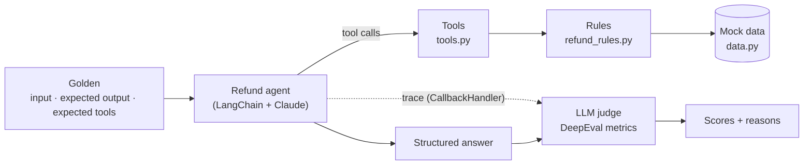

# AI Agent Evaluation

Evaluating a tool-using LLM agent end to end with [DeepEval](https://deepeval.com): a customer-support **refund agent** built with LangChain and Claude, scored by seven metrics that look at its final answers, its tool calls, and its full reasoning trace.

## The idea

Most LLM demos stop at "the agent answered correctly once." Real agents fail in quieter ways: they call a tool they didn't need, retry in a loop, pass the wrong argument, skip a check, or get talked out of a rule by a persistent user. None of that shows up if you only read the final message.

This project takes a small, well-defined agent and asks: **how do you prove it behaves correctly, every time, for the right reasons?** A refund agent is a good subject because its rules are strict and checkable:

- Identify the customer, then look up their purchases.
- Refund only the items the customer asked for.
- Refund only items that were really purchased, within 30 days, and not dated in the future.
- Issue at most one refund ticket, with the amount the system calculated.
- Never bend the rules because a customer insists.

## What this project demonstrates

- **A rule-enforcing agent design.** Business rules live in code (`agent/refund_rules.py`) and are re-checked by the tools, so even a wrong model decision cannot produce a wrong refund. The prompt explains the rules; the code guarantees them.
- **A layered evaluation suite.** Seven DeepEval metrics cover three levels: the final answer, the tool calls, and the trace (planning and efficiency).
- **A deliberate test dataset.** Twelve goldens grouped by scenario: happy paths, partial refunds, rejections, missing information, non-refund requests, and adversarial prompts.
- **Repeatable evaluation.** "Today" is frozen and refund state is reset before every test case, so results do not drift with the calendar or leak between cases.

## What I wanted to learn

- How to evaluate an **agent**, not just a model: tool selection, arguments, plans, and step efficiency.
- The difference between **trace-based** metrics (judge reads the whole run) and **single-turn** metrics (judge reads an input/output pair).
- How to write **prompts, tool docstrings, and error messages** that a model follows reliably, and why all three must stay in sync.
- How to tell a **real agent failure** from an **evaluation failure** (a blind judge, a leaking test, a date-dependent expectation).

## How it works



The agent exposes three tools:

| Tool | What it does |
| --- | --- |
| `get_user_purchase_history` | Returns the customer's purchases with price, date and `days_since_purchase` |
| `calculate_right_refund` | Returns the refund amount for eligible items, plus rejected items with reasons |
| `issue_refund_ticket` | Issues the refund after re-checking the user, the amount, and duplicate refunds |

## Evaluation metrics

| Metric | Type | Question it answers | Script |
| --- | --- | --- | --- |
| Task Completion | Trace | Did the agent achieve the task under the refund rules? | `task_completion.py` |
| Step Efficiency | Trace | Did it get there without redundant steps or retries? | `step_efficiency.py` |
| Plan Quality | Trace | Was its plan complete and logical? | `plan_quality.py` |
| Plan Adherence | Trace | Did it follow its own plan? | `plan_adherence.py` |
| Tool Correctness | Single-turn | Did it call the expected tools? | `tool_correctness.py` |
| Argument Correctness | Single-turn | Were the tool arguments right for the request? | `argument_correctness.py` |
| Answer Correctness (GEval) | Single-turn | Does the final answer reach the expected conclusion? | `answer_correctness.py` |

`complete_eval.py` runs all seven on a single agent run per golden, so every metric judges the same response.

## Project structure

```
.
├── agent/
│   ├── agent.py           # Agent definition + interactive console demo
│   ├── prompts.py         # System prompt (workflow, rules, response formats)
│   ├── tools.py           # LangChain tools exposed to the agent
│   ├── refund_rules.py    # Business rules: refund window, dates, eligibility
│   ├── objects.py         # Pydantic schemas (structured answer, purchase item)
│   ├── models.py          # Chat model (Claude Haiku 5.5)
│   └── data.py            # Mock purchase database
├── evaluations/
│   ├── dataset.py         # 12 goldens + frozen evaluation date
│   ├── model.py           # LLM judge used by all metrics
│   ├── complete_eval.py   # All seven metrics in one run
│   └── *.py               # One script per metric
├── pyproject.toml
└── .env.template
```

## Getting started

Requirements: Python 3.12+, [uv](https://docs.astral.sh/uv/), and an Anthropic API key.

```bash
# 1. Install dependencies
uv sync

# 2. Add your API key
cp .env.template .env
# then edit .env: ANTHROPIC_API_KEY=...

# 3. Chat with the agent
uv run python agent/agent.py

# 4. Run one metric, or all of them
uv run python evaluations/task_completion.py
uv run python evaluations/complete_eval.py
```

All evaluation results assume the date `2026-10-31` (`FROZEN_TODAY` in `evaluations/dataset.py`); the scripts set it automatically through the `REFUND_FAKE_TODAY` environment variable.

## Lessons learned

- **Isolate every test case.** Refund history was stored in memory and leaked between goldens, so a correct refund was rejected as a duplicate. Each case now resets state first.
- **Freeze time.** Expected results depended on the real date; one item would silently flip from eligible to ineligible a few days later.
- **Error messages are instructions.** A tool error that said "recalculate" made the agent retry in a loop. It now says "This is final. Do not retry."
- **Don't expose tools the agent doesn't need.** An unused date tool kept getting called and was flagged as a redundant step.
- **Check what the judge can see.** Several "failures" came from an LLM judge that could not see the customer's request in the trace and guessed. Read the judge's reason before changing the agent.

## Known issues

- **Structured output appears as a tool call.** `response_format=Answer` is implemented by LangChain as a pseudo-tool named `Answer`. Tool Correctness counts it as an unexpected tool, so cases where the agent correctly calls no tools (e.g. asking for a username) fail, and Step Efficiency sometimes flags it as an extra step.
- **The trace does not record the customer's input.** The LangChain `CallbackHandler` captures LLM and tool spans but not the user message, so trace-based judges can misread what was asked.
- **Duplicated setup.** Every evaluation script repeats the same setup (frozen date, `sys.path`, state reset, agent call).

## Future improvements

- **Add a shared `evaluations/runner.py`.** Not included yet. It would centralize the repeated setup and wrap each agent call with DeepEval's `@observe` and `update_current_trace(input=..., output=..., tools_called=...)`, which fixes both known issues above: the judge sees the customer's request, and the `Answer` pseudo-tool is filtered out of `tools_called`.
- **Use native structured output.** Switch `response_format` to LangChain's `ProviderStrategy` if supported, so `Answer` no longer appears as a tool call at all.
- **Make the project a proper package.** Replace the `sys.path` manipulation with package imports (`from agent.tools import ...`) configured in `pyproject.toml`.
- **Add unit tests for `refund_rules.py`.** Cover name normalization, the day-30/day-31 boundary, future dates, and duplicate items, without calling a model.
- **Cover more data.** Users `user127`–`user132` are not used by any golden yet, and no purchase is dated in the future, so the future-date rule is untested.
- **Evaluate multi-turn conversations.** The agent supports follow-up turns (e.g. asking for a username, then continuing); the dataset only tests single messages.
- **Use a stronger judge.** The judge currently uses the same small model as the agent; a stronger model would give more reliable verdicts on borderline cases.
- **Persist refunds per item.** Refund history is an in-memory total per user; a real system needs a database keyed by item and order.
- **Run evaluations in CI** and track scores over time to catch regressions when the prompt or tools change.

## Tech stack

Python · [LangChain](https://python.langchain.com) · [LangGraph](https://langchain-ai.github.io/langgraph/) · [Anthropic Claude](https://www.anthropic.com/claude) · [DeepEval](https://deepeval.com) · Pydantic · uv

## References

- [AI agent evaluation video tutorial (YouTube)](https://www.youtube.com/watch?v=eL9BRo-eFYY) — the tutorial this project is based on
- [DeepEval documentation](https://deepeval.com/docs/getting-started-agents) — agent evaluation metrics and tracing
- [DeepEval LangChain integration](https://www.deepeval.com/integrations/frameworks/langchain)
